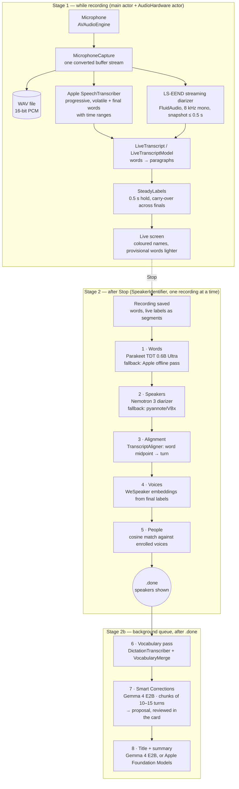
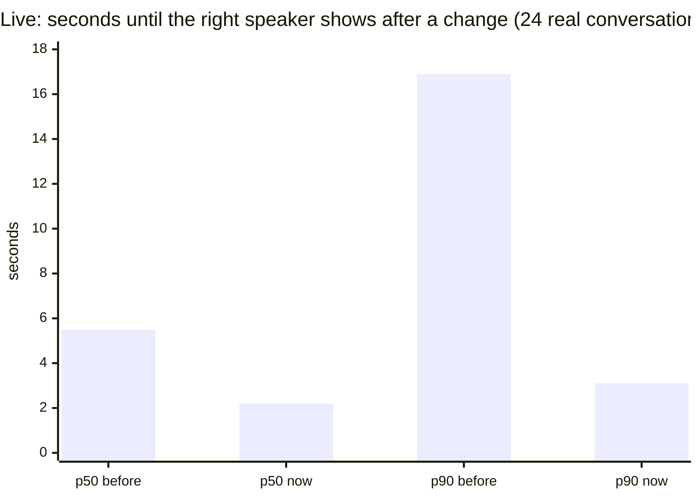
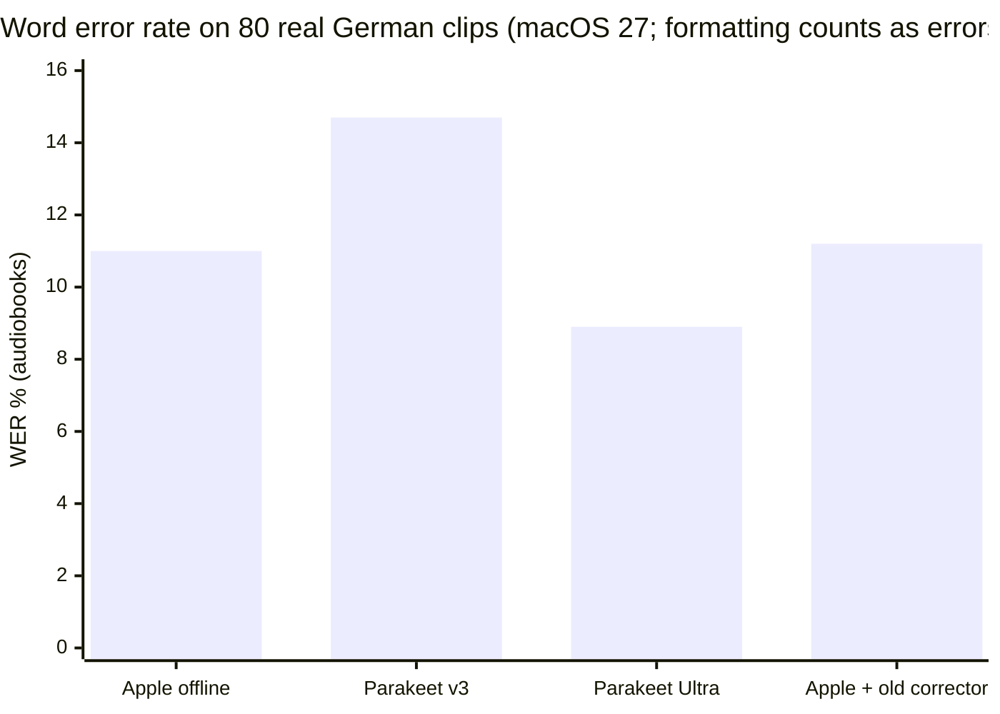
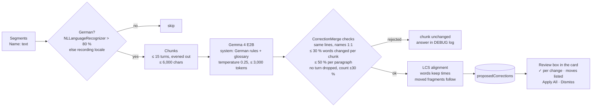
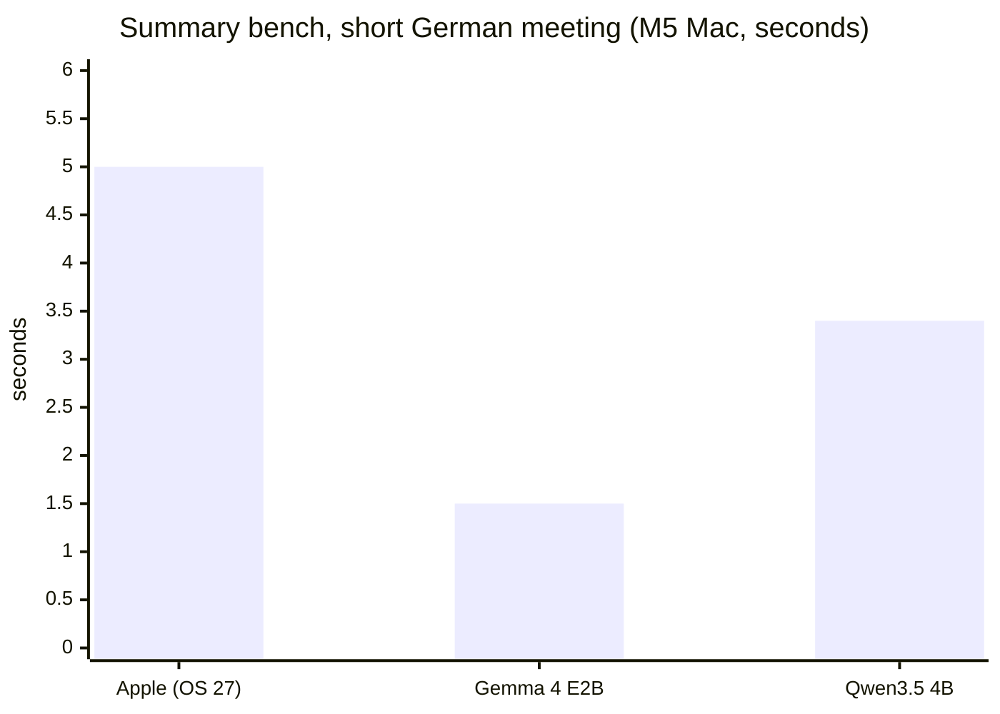

# Scribe's pipeline

What happens to audio from the moment Record is tapped until the transcript has its speakers, its corrections and its summary — every model, every step, with the numbers measured so far. Then the ideas on the table and where they would go, and what was tried and dropped. The README holds the full design rationale; this is the map. (State: October 2026.)

Everything runs on the iPhone. Nothing leaves it except the user-initiated model downloads (Parakeet, Nemotron, Gemma/Qwen, pinned Hugging Face revisions).

## 1. The two stages

The status line under the date names the running step: *Transcribing… → Refining speakers… → Checking vocabulary… → Correcting text… → Writing summary…*.

## 2. Models

| Role | Model | Runtime | Size | Downloaded | Measured |
|---|---|---|---|---|---|
| Live ASR | Apple `SpeechTranscriber` (progressive) | Speech framework | system | locale asset once | finals ~15 s after speech (p50 8.7 s) |
| Live diarization | LS-EEND (FluidAudio) | CoreML | 43 MB | automatic | right speaker p50 2.2 s / p90 3.1 s after a change |
| Offline ASR | NVIDIA Parakeet TDT 0.6B "Ultra" | CoreML via FluidAudio | ~610 MB | Wi-Fi automatic / on demand | 8.9 % WER audiobooks, 11.1 % phone calls |
| Offline ASR fallback | Apple `SpeechTranscriber` (offline, full context) | Speech framework | system | — | 11.0 % / 11.1 % |
| Offline diarization | NVIDIA Nemotron 3 | CoreML via FluidAudio | ~100 MB | Wi-Fi automatic / on demand | 2.22 → 1.77 % wrong words with alignment offset (DiarBench) |
| Diarization fallback | pyannote community-1 + VBx | CoreML via FluidAudio | ~21 MB | first use | weaker; recognition thresholds stricter for its speakers |
| Voice embeddings | WeSpeaker (FluidAudio) | CoreML | in the 21 MB | with pyannote | 256-d, unit length |
| Vocabulary pass | Apple `DictationTranscriber` | Speech framework | system | — | honours contextual strings; whole-file pass = most of the post-stop time |
| Corrections + summaries | Gemma 4 E2B 4-bit (default) | MLX, GPU | 3.6 GB | Settings | 1.5 s short summary, 2.4 s for 8.3K tokens (M5 Mac) |
| Comparison models | Gemma 4 E4B 4-bit · Qwen3.5 4B 4-bit | MLX, GPU | 5.1 GB · 3.1 GB | Settings picker | Qwen: most complete summaries, ~4× E2B's time, peak 3.8 GB |
| Summary fallback | Apple Foundation Models (~3B) | FoundationModels | system | — | 4K/8K-token window; wordy, meta-style summaries |

## 3. Stage 1 in detail — live

| Step | What happens | Why this way |
|---|---|---|
| Capture | `AVAudioEngine` on the `AudioHardware` actor; one tap writes the WAV *and* yields buffers to the analyzer *and* resamples to 8 kHz for LS-EEND, all with the same frame positions | file time == transcript time == diarizer time; never on the main thread (the card opens straight onto the empty transcript) |
| ASR | `SpeechAnalyzer` + `SpeechTranscriber`, volatile results on, `audioTimeRange` on | provisional text arrives as one run; finals every ~15 s of speech |
| Diarization | LS-EEND snapshots at most every 0.5 s, exclusive turns, speaker indices by first appearance | measured against Sortformer/pyannote-streaming: best latency |
| Labelling | every word (provisional too) gets the turn under its midpoint; one-word islands between two agreeing neighbours are smoothed | labelling only finals left a new speaker's first words under the old one for seconds |
| Stability | `SteadyLabels`: a name shows once its label has held 0.5 s; the hold carries over when a provisional word is finalized; words after a final's end are kept, not dropped | names shown/hidden/shown again 372–624 → 4–17 times in a replay of 40 synthetic conversations |

## 4. Stage 2 in detail — after Stop

### Step 1 · Words
The WAV is transcribed again with full context. Parakeet Ultra when chosen, downloaded and the language is supported (25 European languages), else Apple's offline pass. Word times from Parakeet's token timings (shifted by `alignmentOffset` −0.12 s for the turns). Better words replace the live ones at once, with the live labels re-applied; changed words flash. Runs once per transcript (`wordsRefined`).

Phone calls: Apple 11.1 %, Parakeet Ultra 11.1 % (equal); audiobooks CER 4.4 → 2.4 %. Speed: ~6 s for 15.5 min of audio on an M-series Mac.

### Step 2 · Speakers
Nemotron 3 diarizes the file (`.automatic`, or `.exactly(n)` from the Speakers menu). pyannote/VBx until Nemotron is downloaded. Offline, the recording stays `pending` with a note and is retried on the next foreground.

### Step 3 · Alignment
`TranscriptAligner.finalSpeakers`: each word takes the turn with the largest overlap, a word touching no turn the turn whose midpoint is nearest; **no** island smoothing on the final labels (it erased real one-word turns: 2.43 → 2.22 % without it). Consecutive same-speaker words fold into a paragraph, split at silences > 2 s.

### Step 4 · Voices
`VoiceWindows` picks each speaker's clean audio from the final labels; WeSpeaker embeds it (repeated, never zero-padded).

### Step 5 · People
Cosine match against the enrolled people (`PeopleDirectory`); thresholds depend on the diarizer (stricter for pyannote's less pure speakers). Named speakers get the person's name; renaming a speaker enrolls or re-enrols the voice.

### Step 6 · Vocabulary pass (background)
Only with a vocabulary. `DictationTranscriber` over the whole file with the terms as contextual strings; `VocabularyMerge` takes over **only** the terms it recognized, at the same time (±0.15 s), replacing the most similar word run (Levenshtein ≤ 50 %): "Bufin" → "BaFin", "KoFin Pro" → "Cofinpro"; plus case fixes ("Marisk" → "MaRisk"). Everything else stays Parakeet's. Words are re-aligned with the stored turns, so speakers and names stay.

### Step 7 · Smart Corrections (background, experimental, off by default)

Rules given to the model (verbatim, German): only grammar, spelling, punctuation and obviously misheard words; never content, style or wording; a fragment that clearly belongs to the previous speaker is appended there; unintelligible → `[unklar]`; keep "Name: Text"; output only the transcript. The vocabulary follows as a glossary ("so schreiben, wenn sie offensichtlich gemeint sind, aber nicht einsetzen, wo ein anderes Wort passt").

Every answered chunk extends the stored proposal, so an interrupted pass (app resigns active — Gemma runs in the foreground only; a recording starts) goes on from `correctedUntil`. Not yet measured on real recordings.

### Step 8 · Title and summary (background)
`TranscriptTitler`: the transcript as "Name: text" lines; Gemma (Better Summaries on) asks for three lines "Topics / Summary / Title" with the task repeated after the text, greedy; Apple's model (fallback) with a `@Generable` `TitleAndSummary` and a plain-text retry on refusal. Parts sized by the model's window (Gemma 65,450 characters, Apple 9,786 / 24,122), map-reduce for longer transcripts. The title only replaces a name the app gave.

## 5. Scheduling and limits

| Concern | Rule |
|---|---|
| Order | a stopped recording's own steps first; the one-time sweeps (voices, titles) wait and pause while recording |
| GPU | Gemma/Qwen only in the foreground (iOS gives no background GPU); cancelled when the app resigns active, retried on return |
| Memory | Gemma unloaded after 60 s idle, when a recording starts, when the app backgrounds; peak 3.7 GB (E2B) |
| Main thread | every press answers in its frame: no sync fetches/IO/model calls in actions or bodies |
| Crash recovery | `.processing` rows go back to `.pending`; `vocabularyPending` / `correctionsPending` are resumed by the launch sweep |

## 6. Ideas on the table

From a review of an "optimal pipeline" proposal (October 2026), kept where they add something Scribe lacks.

| # | Idea | Where it fits | What it could improve | Risk / cost | Priority |
|---|---|---|---|---|---|
| 1 | **Thermal awareness**: watch `ProcessInfo.thermalState`; at `.serious` widen LS-EEND's step, drop volatile results | Stage 1, `RecordingSession` | fewer dropped frames and less throttling in long recordings | low; half a day | **now** |
| 2 | **Context turns around correction chunks**: send the previous 2 turns marked "do not edit" | Step 7, `TranscriptCorrector.chunk` | rule-3 moves across chunk borders; better sentence boundaries | more tokens per request (~10 %); half a day | **now** |
| 3 | **Speaker naming from the text**: "I'm Anna" / being addressed → map label to name, null without explicit evidence | after Step 5, before Step 8 | names for speakers whose voice isn't enrolled | false names are costly; needs the review-box pattern; 2 days | later |
| 4 | **Overlap handling**: mark words in overlapping speech `[overlap]`, keep both labels | Step 3 | truthful transcripts of crosstalk | Nemotron gives exclusive turns; would need another signal; large | later |
| 5 | **Glossary extraction pass**: LLM lists proper nouns + their ASR variants before correcting | before Step 7 | catches terms not in the vocabulary | one more full read per transcript; test the static glossary first | test first |
| 6 | **VAD gating** (Silero v6) of the live diarizer | Stage 1 | battery on silent stretches | LS-EEND is already cheap; low gain | low |
| 7 | **Alternative transcriptions** as hints for the corrector | Step 7 | the model picks among the recognizer's own candidates | Parakeet (default) has none; Apple path only | low |
| 8 | **Structured edits** (`@Generable` edit list) | Step 7 | typed output instead of parsing | no constrained decoding in MLX; the line format + LCS does the job | drop |

## 7. Tried and dropped

| What | Measured / observed | Verdict |
|---|---|---|
| **Apple Foundation Models as corrector** (word-level, suspects from confidence + spell check, vocabulary hints, code-side guards) | 80 real clips: WER 11.0 → 11.2 %; pushed terms into ordinary words ("Es" → "ESG", "rollen" → "Rollout"); gains only on synthetic voices' garbled non-words | replaced by Gemma on whole turns with a review step |
| **Synthetic macOS voices as test audio** | 20 % WER, large LLM gains — all from formant-synthesizer artefacts | real speech only |
| **Parakeet v3** | 12.3 % / 14.7 % WER, worse than Apple | Ultra instead |
| **Text-only Gemma 4 E2B int4** (2.67 GB) | "Zusammenfassung der nächsten Schritte"-style summaries | full 4-bit build with towers dropped at load |
| **Gemma with Google's sampling** (T 1.0, top-p 0.95, top-k 64) for summaries | worse than greedy on the test meeting | greedy for titles; 0.25 only for corrections |
| **Gemma without repeating the task after the transcript** | continued writing the transcript ("Anna Schmidt: …") | `localReminder` |
| **Island smoothing on final labels** | erased real one-word turns: 2.43 → 2.22 % wrong words without it (turns ≤ 3 words: 15.3 → 10.5 %) | smoothing on live labels only |
| **Labelling only finalized words live** | a new speaker's first words under the previous speaker for seconds | provisional words labelled too |
| **Sortformer / streaming pyannote live** | slower to the right speaker than LS-EEND | LS-EEND |
| **A pipeline step row with checkmarks and times** | read as a progress panel inside a document | one Mail-style status line |
| **`apple.intelligence` glyph in front of the summary placeholder** | redundant with the status line | dropped |
| **`scrollPosition` binding for search hits** | tracked the paragraph near the anchor and kept it in place when the content changed | `ScrollViewReader` |
| **A top `safeAreaBar` for the back button** | switched off text selection in the card on iOS 27 | overlay |
| **`ViewThatFits` for row layout** | measured off the main thread, trapped in Swift 6's isolation check | `nonisolated` custom layout |
| **Starting Gemma while recording** | GPU and memory belong to the recording | waits for Stop |
| **Continuous-ink waveform in the app icon** (six forms) | read as handwriting or an ECG at icon size | kept, then redesigned as a fading wave into a scribble |
| **Activity mark: three bodies, then code-drawn feathers** (falling through the frame; rocking through three tilts) | the bodies said nothing about the app; the falling feather was out of sight half the time; procedurally rasterized feathers came out lumpy, like brushes or torches | a hand-drawn 16 × 16 pixel quill that only jitters a cell; the same quill at 24 × 24 is the app icon |

## 8. Open measurements

- Pipeline step times on the iPhone 17 (nothing after Stop has been timed on a device).
- Smart Corrections: WER/CER, term accuracy and false edits on the 80 clips with Parakeet words; the review box is the first instrument for this.
- E4B and Qwen3.5 on the device: load, memory, time per chunk.
- Live labels on real ASR/LS-EEND output rather than synthetic replays (`build/qa/livebench`).
